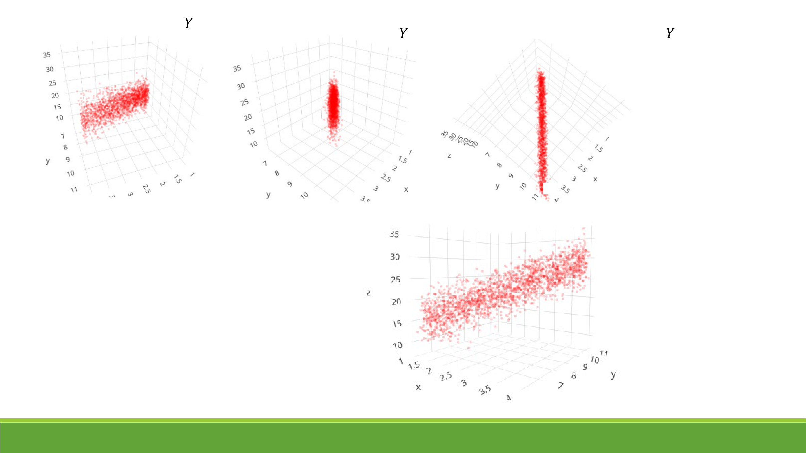
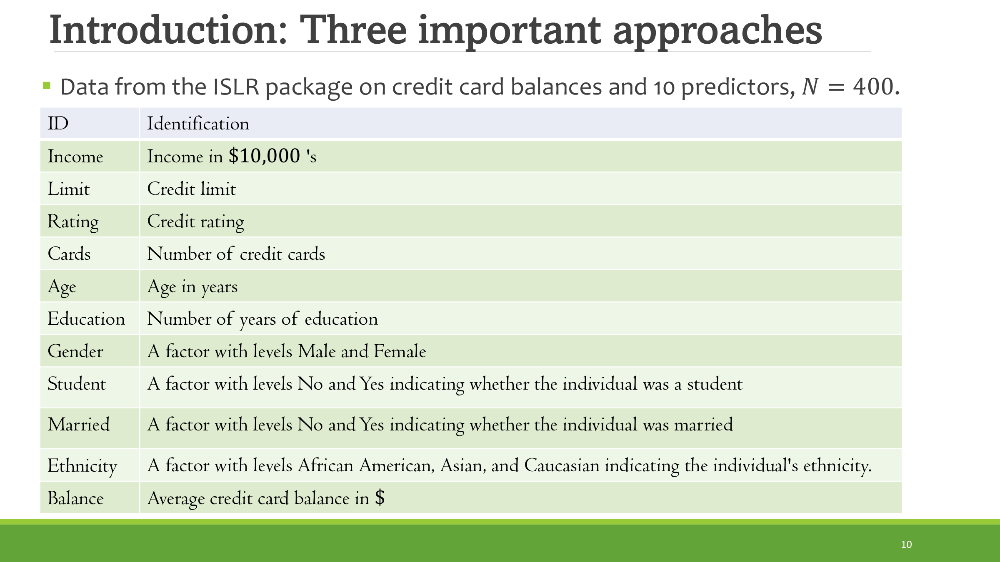

# CHAPTER TWO

**Regression with penalization: subset selection**

- Module Code: **EC4308**
- Module title: **Machine Learning and Economic Forecasting**
- Instructor: **Vu Thanh Hai**
- Reference: **ISLR §6.1**
- Acknowledgement: I adapt Dr. Denis Tkachenko's notes with some minor modifications. Thanks to Denis!

# Lecture outline

1. Introduction and motivation
2. **Best subset selection**
3. **Forward stepwise selection**
4. **Backward stepwise selection**
5. Concluding thoughts: pros and cons.

# Introduction and motivation

- The **linear regression model** you have learned is very commonly used to model — recall this is what we are after in predictive modelling under **squared loss**.
- Can describe nonlinear but still **additive** relationships — that is, linear in the coefficients $\beta$'s.
- Linearity yields advantages in **inference**, and in many applications delivers surprisingly good approximations.

# Motivation: is OLS good enough?

We typically fit such models with OLS — why do we have to look for alternatives? **2 key concerns:**

1. **Prediction accuracy**
2. **Model interpretability**

- OLS has low bias if the true relationship is approximately linear.
- If $n$ is large relative to $p$ (the "typical" metrics-textbook setting), OLS also has low variance — no need to do anything.

# Motivation: prediction accuracy

- When $p$ is **not much larger than** $n$, OLS predictions have high variance → **overfit** → poor OOS prediction.
- When $p > n$ (or $p \approx n$), there is **no unique solution**: OLS variance is infinite — we cannot use this method at all.
- Our goal: get a good linear combination of the predictors to forecast $Y$ well.
- We want to reduce variance by reducing model complexity at a minor cost in terms of **bias** — constrain coefficients on some $\beta$'s to 0, or shrink them.

# Interactive: in-sample vs out-of-sample error

Drag the slider. The true model uses **3** signal predictors; the rest are pure noise. Watch the in-sample error keep falling as you add predictors, while the out-of-sample (forecast) error bottoms out near the true model and then climbs — **the essence of overfitting.**

```{=html}
<div id="ovf-widget" style="width:100%;max-width:900px;margin:0 auto">
  <div style="display:flex;align-items:center;gap:1em;margin-bottom:.5em">
    <label for="ovf-k" style="font-weight:600">Model size k (predictors included):</label>
    <input type="range" id="ovf-k" min="0" max="12" value="3" step="1" style="flex:1">
    <span id="ovf-kval" style="font-weight:600;min-width:2em;text-align:center">3</span>
  </div>
  <div id="ovf-plot" style="width:100%"></div>
  <p id="ovf-readout" style="margin-top:.6em;text-align:center"></p>
</div>
<script>
(function(){
  var P=12, SEED=20241013, TR_N=60, TE_N=2000;
  var SIG=[2.5,-1.8,1.2], NOISE=1.0;
  function mulberry32(a){return function(){a|=0;a=a+0x6D2B79F5|0;var t=Math.imul(a^a>>>15,1|a);t=(t+Math.imul(t^t>>>7,61|t))^t;return((t^t>>>14)>>>0)/(2**32);}}
  var rng=mulberry32(SEED);
  function rnorm(){var u=0,v=0;while(u===0)u=rng();while(v===0)v=rng();return Math.sqrt(-2*Math.log(u))*Math.cos(2*Math.PI*v);}
  function mk(n){var X=[];for(var i=0;i<n;i++){var x=[];for(var j=0;j<P;j++)x.push(rnorm());var y=0;for(var s=0;s<SIG.length;s++)y+=SIG[s]*x[s];X.push({x:x,y:y+rnorm()*NOISE});}return X;}
  var Xtr=mk(TR_N),Xte=mk(TE_N);
  var A0tr=[],Y0tr=[],A0te=[],Y0te=[];
  for(var i=0;i<TR_N;i++){var z=[1].concat(Xtr[i].x);A0tr.push(z);Y0tr.push(Xtr[i].y);}
  for(var i=0;i<TE_N;i++){var z=[1].concat(Xte[i].x);A0te.push(z);Y0te.push(Xte[i].y);}
  function rss(A,y,k,b){var s=0;for(var i=0;i<A.length;i++){var p=b[0];for(var j=0;j<k;j++)p+=b[j+1]*A[i][j+1];var e=y[i]-p;s+=e*e;}return s/A.length;}
  var trMSE=[],teMSE=[];
  for(var k=0;k<=P;k++){
    var Ar=[],yr=[],Ae=[],ye=[];
    for(var i=0;i<A0tr.length;i++){Ar.push(A0tr[i].slice(0,k+1));yr.push(Y0tr[i]);}
    for(var i=0;i<A0te.length;i++){Ae.push(A0te[i].slice(0,k+1));ye.push(Y0te[i]);}
    var pm=k+1,M=[];for(var r=0;r<pm;r++){M.push(new Array(pm+1).fill(0));}
    for(var i=0;i<Ar.length;i++){for(var r=0;r<pm;r++)for(var c=0;c<pm;c++)M[r][c]+=Ar[i][r]*Ar[i][c];for(var r=0;r<pm;r++)M[r][pm]+=Ar[i][r]*yr[i];}
    for(var c=0;c<pm;c++){var piv=c;for(var r=c+1;r<pm;r++)if(Math.abs(M[r][c])>Math.abs(M[piv][c]))piv=r;var tmp=M[c];M[c]=M[piv];M[piv]=tmp;var d=M[c][c]||1e-12;for(var j=c;j<=pm;j++)M[c][j]/=d;for(var r=0;r<pm;r++){if(r===c)continue;var f=M[r][c];for(var j=c;j<=pm;j++)M[r][j]-=f*M[c][j];}}
    var b=[];for(var r=0;r<pm;r++)b.push(M[r][pm]);
    trMSE.push(rss(Ar,yr,k,b));teMSE.push(rss(Ae,ye,k,b));
  }
  var W=860,H=380,ML=64,MR=20,MT=24,MB=46;
  var xMax=12, yMin=0, yMax=Math.max.apply(null,teMSE)*1.15;
  function draw(k){
    var box=document.getElementById('ovf-plot');box.innerHTML='';
    var NS='http://www.w3.org/2000/svg';
    var svg=document.createElementNS(NS,'svg');svg.setAttribute('viewBox','0 0 '+W+' '+H);svg.setAttribute('width','100%');svg.setAttribute('style','max-width:'+W+'px');
    function X(v){return ML+(W-ML-MR)*(v/xMax);}
    function Y(v){return H-MB-(H-MT-MB)*((v-yMin)/(yMax-yMin));}
    function poly(pts,col,w){var d='';for(var i=0;i<pts.length;i++){var x=X(i),yy=Y(pts[i]);d+=(i?'L':'M')+x.toFixed(1)+' '+yy.toFixed(1)+' ';}var p=document.createElementNS(NS,'path');p.setAttribute('d',d);p.setAttribute('fill','none');p.setAttribute('stroke',col);p.setAttribute('stroke-width',w);svg.appendChild(p);}
    poly(trMSE,'#1f3864',2.4);poly(teMSE,'#c00000',2.8);
    function mkNS(t){return document.createElementNS(NS,t);}
    var g=mkNS('g');svg.appendChild(g);
    var xl=mkNS('line');xl.setAttribute('x1',ML);xl.setAttribute('y1',H-MB);xl.setAttribute('x2',W-MR);xl.setAttribute('y2',H-MB);xl.setAttribute('stroke','#333');g.appendChild(xl);
    var yl=mkNS('line');yl.setAttribute('x1',ML);yl.setAttribute('y1',MT);yl.setAttribute('x2',ML);yl.setAttribute('y2',H-MB);yl.setAttribute('stroke','#333');g.appendChild(yl);
    for(var kk=0;kk<=xMax;kk++){var tx=mkNS('text');tx.setAttribute('x',X(kk));tx.setAttribute('y',H-MB+18);tx.setAttribute('text-anchor','middle');tx.setAttribute('font-size','11');tx.textContent=kk;g.appendChild(tx);}
    var yticks=5;for(var t=0;t<=yticks;t++){var vv=yMin+(yMax-yMin)*t/yticks;var ty=mkNS('text');ty.setAttribute('x',ML-8);ty.setAttribute('y',Y(vv)+4);ty.setAttribute('text-anchor','end');ty.setAttribute('font-size','10');ty.textContent=vv.toFixed(1);g.appendChild(ty);}
    var tm=mkNS('line');tm.setAttribute('x1',X(3));tm.setAttribute('x2',X(3));tm.setAttribute('y1',MT);tm.setAttribute('y2',H-MB);tm.setAttribute('stroke','#999');tm.setAttribute('stroke-dasharray','4 4');svg.appendChild(tm);
    var tmt=mkNS('text');tmt.setAttribute('x',X(3));tmt.setAttribute('y',MT-6);tmt.setAttribute('text-anchor','middle');tmt.setAttribute('font-size','11');tmt.setAttribute('fill','#666');tmt.textContent='true model (k=3)';svg.appendChild(tmt);
    var cl=mkNS('line');cl.setAttribute('x1',X(k));cl.setAttribute('x2',X(k));cl.setAttribute('y1',MT);cl.setAttribute('y2',H-MB);cl.setAttribute('stroke','#888');cl.setAttribute('stroke-width','1');svg.appendChild(cl);
    function dot(cx,cy,col){var c=mkNS('circle');c.setAttribute('cx',cx);c.setAttribute('cy',cy);c.setAttribute('r','5');c.setAttribute('fill',col);c.setAttribute('stroke','#fff');c.setAttribute('stroke-width','2');svg.appendChild(c);}
    dot(X(k),Y(trMSE[k]),'#1f3864');dot(X(k),Y(teMSE[k]),'#c00000');
    var LGM=Math.max(ML,W-MR-240);
    function litem(y,lab,col){var l=mkNS('line');l.setAttribute('x1',LGM);l.setAttribute('y1',y);l.setAttribute('x2',LGM+26);l.setAttribute('y2',y);l.setAttribute('stroke',col);l.setAttribute('stroke-width','2.5');svg.appendChild(l);var t=mkNS('text');t.setAttribute('x',LGM+32);t.setAttribute('y',y+4);t.setAttribute('font-size','11');t.textContent=lab;svg.appendChild(t);}
    litem(MT+6,'in-sample','#1f3864');litem(MT+26,'out-of-sample','#c00000');
    box.appendChild(svg);
    var ro=document.getElementById('ovf-readout');
    ro.innerHTML='In-sample MSE <b style="color:#1f3864">'+trMSE[k].toFixed(2)+'</b> &nbsp;·&nbsp; out-of-sample MSE <b style="color:#c00000">'+teMSE[k].toFixed(2)+'</b>';
  }
  var slider=document.getElementById('ovf-k');var kval=document.getElementById('ovf-kval');
  function upd(){var k=parseInt(slider.value,10);kval.textContent=k;draw(k);}
  slider.addEventListener('input',upd);
  upd();
})();
</script>
```

*In-sample MSE shrinks as $k$ grows — adding predictors always fits the training data better. But out-of-sample MSE bottoms out near the true model ($k=3$) and then rises: extra predictors model noise, not signal.*

# Motivation: Interpretability

- Often many $\beta$'s entering the regression are irrelevant.
- OLS will **almost never** set coefficients exactly to 0.
- By removing potentially many such variables (setting their $\beta$'s to 0), we enhance model interpretability — sacrifice "small details" to get the "big picture".
- **Caution:** "interpretation" here need not mean causal effect! Rather, which variables can be important **predictors**.

# Introduction: Three important approaches

- **Subset selection:** find a (hopefully small) subset of the $X$'s that yields good performance; fit OLS on this subset.
- **Shrinkage:** fit a model using all $p$ variables, but shrink coefficients toward 0 relative to OLS (some can go to exactly 0).
- **Dimension reduction:** attempt to "summarize" the $p$ predictors with $m < p$ linear combinations of the variables (e.g., principal components).

We will talk about the **first approach** today.

# Motivation (illustration)

{width="80%"}

# Subset Selection

- We try to find a possibly sparse subset of the $X$'s that forecasts well: find the predictors needed for a high-quality forecast.
- Dropping a variable $=$ setting its coefficient to zero — a form of penalty called the **$L_0$ penalty**: $\|\beta\|_0 = \sum_j \mathbf{1}\{\beta_j \neq 0\}$ (the number of nonzero coefficients).
- **Bias/variance tradeoff:** leave out a variable highly correlated with the signal → bias; put in too many $X$'s → high variance.
- In principle, want to try out **all possible combinations** and choose the one with the best OOS performance.

# The Credit data

Data from the ISLR package on credit card balances and 10 predictors, $n = 400$:

{width="78%"}

# Interactive: imperfect multicollinearity

True model: $y = x_1 + \varepsilon$. Predictor $x_2$ is **correlated** with $x_1$ but does **not** drive $y$ (its true coefficient is $0$). Drag $\rho$ — as it approaches $1$, the 3-D cloud of data points $(x_2, x_1, y)$ flattens: the predictors become near-duplicates and coefficient precision collapses.

```{=html}
<div id="mc-widget" style="width:100%;max-width:920px;margin:0 auto">
  <div style="display:flex;align-items:center;gap:1em;margin-bottom:.5em">
    <label for="mc-rho" style="font-weight:600">Correlation &rho; between x&#8321; and x&#8322;:</label>
    <input type="range" id="mc-rho" min="0" max="99" value="85" step="1" style="flex:1">
    <span id="mc-rhov" style="font-weight:600;min-width:3em;text-align:center">0.85</span>
  </div>
  <p id="mc-readout" style="margin:.2em 0 .4em;font-size:.9em;text-align:center">VIF = 1/(1&#8722;&rho;&sup2;) = <span id="mc-vif">3.69</span> &nbsp;&middot;&nbsp; sd(&beta;&#770;&#8321;) incl. x&#8322;: <span id="mc-sdfull">0.39</span> &nbsp;&middot;&nbsp; sd(&beta;&#770;&#8321;) dropping x&#8322;: <span id="mc-sddrop">0.10</span></p>
  <div style="text-align:center">
    <canvas id="mc-cv" width="620" height="470" style="background:#fff;border:1px solid #e5e5ef;touch-action:none;display:inline-block"></canvas>
  </div>
  <p id="mc-hint" style="margin:.4em 0 0;font-size:12px;color:#666;text-align:center">&#9881; drag to rotate &nbsp;&middot;&nbsp; x = X&#8322;, y = X&#8321;, vertical = Y</p>
</div>
<script>
(function(){
  var cv=document.getElementById('mc-cv'), ctx=cv.getContext('2d');
  var rho=0.85, N=320, B1=1.0, NOISE=1.0;
  function mulberry32(a){return function(){a|=0;a=a+0x6D2B79F5|0;var t=Math.imul(a^a>>>15,1|a);t=(t+Math.imul(t^t>>>7,61|t))^t;return((t^t>>>14)>>>0)/(2**32);}}
  function rnorm(r){var u=0,v=0;while(u===0)u=r();while(v===0)v=r();return Math.sqrt(-2*Math.log(u))*Math.cos(2*Math.PI*v);}
  var raw=[], C=[0,0,0];
  function gen(seed){
    var r=mulberry32(seed||42), R=Math.min(Math.abs(rho),0.99); if(rho<0)R=-R;
    raw=[];
    for(var i=0;i<N;i++){
      var x1=rnorm(r), eta=rnorm(r), x2=R*x1+Math.sqrt(1-R*R)*eta, y=B1*x1+rnorm(r)*NOISE;
      raw.push([x2,y,x1]);
    }
    C=[0,0,0];
    for(var i=0;i<N;i++){C[0]+=raw[i][0];C[1]+=raw[i][1];C[2]+=raw[i][2];}
    C[0]/=N;C[1]/=N;C[2]/=N;
  }
  var az=0.9, el=-0.42, drag=false, lx=0, ly=0;
  var W=620,H=470, SCALE=88;
  function cx(){return W/2+14;} function cy(){return H/2-8;}
  function roty(v,a){var c=Math.cos(a),s=Math.sin(a);return [v[0]*c+v[2]*s, v[1], -v[0]*s+v[2]*c];}
  function rotx(v,a){var c=Math.cos(a),s=Math.sin(a);return [v[0], v[1]*c-v[2]*s, v[1]*s+v[2]*c];}
  function project(p){
    var v=[p[0]-C[0],p[1]-C[1],p[2]-C[2]];
    v=roty(v,az); v=rotx(v,el);
    return {x:cx()+v[0]*SCALE, y:cy()-v[1]*SCALE, d:v[2]};
  }
  function draw(){
    ctx.clearRect(0,0,W,H);
    // faint grid on x2-x1 plane (Y=0)
    ctx.strokeStyle='#ececf4';ctx.lineWidth=1;
    for(var g=-2.4;g<=2.4;g+=0.6){
      var a=project([g,0,-2.4]),b=project([g,0,2.4]);
      ctx.beginPath();ctx.moveTo(a.x,a.y);ctx.lineTo(b.x,b.y);ctx.stroke();
      var c=project([-2.4,0,g]),d=project([2.4,0,g]);
      ctx.beginPath();ctx.moveTo(c.x,c.y);ctx.lineTo(d.x,d.y);ctx.stroke();
    }
    // axes through origin, color-coded
    var len=2.6, axLines=[[1,0,0],[0,1,0],[0,0,1]], cols=['#c0392b','#1f3864','#1f6f2e'], names=['X\u2082','X\u2081','Y'];
    for(var i=0;i<3;i++){
      var pos=project([axLines[i][0]*len,axLines[i][1]*len,axLines[i][2]*len]);
      var neg=project([-axLines[i][0]*len,-axLines[i][1]*len,-axLines[i][2]*len]);
      ctx.strokeStyle='#444';ctx.lineWidth=2;
      ctx.beginPath();ctx.moveTo(neg.x,neg.y);ctx.lineTo(pos.x,pos.y);ctx.stroke();
      ctx.fillStyle=cols[i];ctx.font='bold 14px sans-serif';
      ctx.fillText(names[i], pos.x+6*axLines[i][0], pos.y+6*axLines[i][1]-4);
    }
    // points: depth-sort, size+fade depth cue
    var order=[];
    for(var i=0;i<N;i++){order.push({q:project(raw[i])});}
    order.sort(function(a,b){return a.q.d-b.q.d;});
    for(var i=0;i<order.length;i++){
      var q=order[i].q, dd=(q.d+3.5)/7;
      ctx.globalAlpha=0.30+0.5*dd;
      ctx.fillStyle='#1f3864';
      ctx.beginPath();ctx.arc(q.x,q.y,1.6+1.7*dd,0,6.2832);ctx.fill();
    }
    ctx.globalAlpha=1;
  }
  function upd(){
    rho=parseInt(document.getElementById('mc-rho').value,10)/100;
    document.getElementById('mc-rhov').textContent=rho.toFixed(2);
    var vif=1/(1-rho*rho); document.getElementById('mc-vif').innerHTML=vif.toFixed(2);
    gen(rho*1000+7); draw();
  }
  function dd(e){var r=cv.getBoundingClientRect();var t=e.touches?e.touches[0]:e;return [t.clientX-r.left,t.clientY-r.top];}
  function down(e){drag=true;var p=dd(e);lx=p[0];ly=p[1];cv.style.cursor='grabbing';}
  function move(e){if(!drag)return;var p=dd(e);az+=(p[0]-lx)*0.008;el+=(p[1]-ly)*0.008;lx=p[0];ly=p[1];if(el>1.3)el=1.3;if(el<-1.3)el=-1.3;draw();}
  function up(){drag=false;cv.style.cursor='grab';}
  cv.addEventListener('mousedown',down);window.addEventListener('mousemove',move);window.addEventListener('mouseup',up);
  cv.addEventListener('touchstart',down);cv.addEventListener('touchmove',function(e){e.preventDefault();move(e);},{passive:false});window.addEventListener('touchend',up);
  document.getElementById('mc-rho').addEventListener('input',upd);
  cv.style.cursor='grab';
  upd();
})();
</script>
```

*As $\rho \to 1$ the cloud flattens onto a low-dimensional shape — $x_1$ and $x_2$ carry nearly the same information, so the fitted coefficients become individually unstable ($\text{VIF}=1/(1-\rho^2)$) even though combined prediction stays fine. Dropping the redundant $x_2$ (subset selection) restores a precise, unbiased $\hat\beta_1$.*